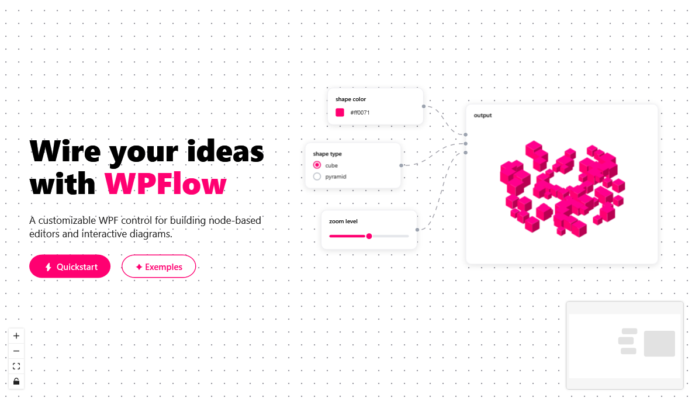

# Wpflow

**Ajoutez un éditeur de nodes à votre application WPF ou Blazor.**

Wpflow affiche des boîtes (les *nodes*) reliées par des liens (les *edges*), que l'utilisateur déplace et connecte à la souris. Il sert à construire un éditeur de workflow, un pipeline de données, une programmation visuelle ou un schéma interactif. C'est un portage .NET inspiré de [React Flow (xyflow)](https://reactflow.dev/).



**[Voir la documentation et les exemples interactifs](https://bizouarn.github.io/wpflow/)** (les exemples Blazor s'exécutent dans le navigateur)

## Ce que fait la bibliothèque

- **Naviguer** : zoom, déplacement de la vue, minimap et boutons de contrôle.
- **Éditer** : déplacer, sélectionner, relier, reconnecter, supprimer, annuler et rétablir.
- **Personnaliser** : un node contient vos propres contrôles WPF ou composants Blazor. Edges, marqueurs et couleurs sont remplaçables, avec un thème clair et un thème sombre.
- **Organiser** : groupes et nodes imbriqués, redimensionnement, grille magnétique, disposition automatique.
- **Enregistrer** : import et export JSON au format de React Flow.
- **S'intégrer** : liaison MVVM et commandes en WPF, `@bind` et `EventCallback` en Blazor.
- **Gérer de grands graphes** : la virtualisation limite le rendu à ce qui est proche de la zone visible.

## Installation

| Paquet NuGet | À installer pour | Cibles |
|---|---|---|
| `Wpflow.Wpf` | une application WPF (Windows) | .NET 8 et suivants, .NET Framework 4.7.2 |
| `Wpflow.Blazor` | une application Blazor (Server ou WebAssembly) | .NET 8 et suivants |
| `Wpflow.Core` | manipuler un graphe sans interface (installé avec les deux autres) | .NET 8, .NET Framework 4.7.2, .NET Standard 2.0 |

Les particularités des anciennes cibles sont décrites dans le [guide de démarrage](doc/learn/01-quickstart.md).

## Démarrage rapide

Pour WPF, installez le paquet :

```bash
dotnet add package Wpflow.Wpf
```

Placez un `FlowView` dans votre fenêtre :

```xml
<Window xmlns:flow="clr-namespace:Wpflow.Wpf;assembly=Wpflow.Wpf" …>
    <flow:FlowView x:Name="Flow" FitViewOnInit="True">
        <Grid>                       <!-- le contenu de FlowView est un overlay au-dessus du graphe -->
            <flow:MiniMap />
            <flow:FlowControls />
        </Grid>
    </flow:FlowView>
</Window>
```

Puis donnez-lui des nodes et des edges, dans le constructeur de la fenêtre après `InitializeComponent()` :

```csharp
using Wpflow.Core;

Flow.Nodes =
[
    new Node("1", new XYPosition(0, 0),   "input",   "Début"),
    new Node("2", new XYPosition(250, 80), "default", "Étape"),
    new Node("3", new XYPosition(500, 0),  "output",  "Fin"),
];
Flow.Edges =
[
    new Edge("e1-2", "1", "2", Animated: true),
    new Edge("e2-3", "2", "3", Type: "smoothstep", Label: "ok", MarkerEnd: EdgeMarker.ArrowClosed),
];
```

C'est tout : on peut déplacer les nodes, relier leurs points de connexion (*handles*), zoomer à la molette et déplacer la vue en glissant le fond.

## Démarrage rapide (Blazor)

Installez le paquet :

```bash
dotnet add package Wpflow.Blazor
```

Ajoutez la feuille de style dans la page hôte :

```html
<link rel="stylesheet" href="_content/Wpflow.Blazor/wpflow.css" />
```

Puis utilisez `FlowView` dans un composant interactif :

```razor
@using Wpflow.Blazor
@using Wpflow.Core

<div style="height: 500px">
    <FlowView @bind-Nodes="_nodes" @bind-Edges="_edges">
        <FlowMiniMap />
        <FlowControls />
    </FlowView>
</div>

@code {
    private IReadOnlyList<Node> _nodes =
    [
        new Node("1", new XYPosition(0, 0), "input", "Début"),
        new Node("2", new XYPosition(250, 80), "default", "Étape"),
    ];
    private IReadOnlyList<Edge> _edges = [new Edge("e1-2", "1", "2", Animated: true)];
}
```

## Pour aller plus loin

| Je veux… | Guide |
|---|---|
| comprendre le modèle et gérer l'état | [Concepts](doc/learn/02-concepts.md), [Construire un flow](doc/learn/03-building-a-flow.md) |
| créer mes propres nodes et edges | [Nodes personnalisés](doc/learn/04-custom-nodes.md), [Edges](doc/learn/05-edges.md), [Personnaliser](doc/learn/14-customization.md) |
| régler les gestes et les connexions | [Interactions](doc/learn/09-interactions.md) |
| utiliser des ViewModels (WPF) | [MVVM](doc/learn/13-mvvm.md) |
| enregistrer et recharger un graphe | [Sauvegarde et JSON](doc/learn/12-serialization.md) |
| afficher des milliers de nodes | [Performance et accessibilité](doc/learn/11-performance-accessibility.md) |
| utiliser la version Blazor | [Wpflow.Blazor](doc/blazor.md) |

La [documentation complète](doc/README.md) contient aussi la référence de l'API et les exemples. Si vous venez de React Flow, la [référence de `FlowView`](doc/reference/flowview.md) donne les équivalences.

## Limites connues

- Les deux versions n'ont pas tout en commun : l'adaptateur MVVM (`NodesSource`) n'existe qu'en WPF.
- En Blazor, les lecteurs d'écran et les navigateurs autres que Chrome n'ont pas été vérifiés.
- La validation des connexions (`IsValidConnection`) est synchrone : il n'y a pas de version asynchrone.

## Développement

Les commandes suivantes se lancent depuis la racine du dépôt :

```bash
dotnet run --project demo/wpf         # démo WPF ; « Parcourir les exemples » ouvre les autres cas
ASPNETCORE_ENVIRONMENT=Development dotnet run --project demo/blazor --urls http://localhost:5189   # démo Blazor Server
dotnet run --project demo/blazor-wasm --urls http://localhost:5190                                 # démo Blazor WebAssembly
dotnet run --project demo/docs-site   # site de documentation, sur http://localhost:5191
dotnet test tests/Wpflow.Core.Tests
```

Les sources sont dans `src/` : `Wpflow.Core` contient la logique sans interface, `Wpflow.Wpf` et `Wpflow.Blazor` les deux vues. Pour contribuer, lisez [`CLAUDE.md`](CLAUDE.md) (architecture, commandes et tests) et [`work-doc/`](work-doc/) (roadmap et décisions d'architecture).

## Licence

[MIT](LICENSE). Le portage de xyflow, lui aussi sous licence MIT, est signalé dans [THIRD-PARTY-NOTICES.md](THIRD-PARTY-NOTICES.md).
