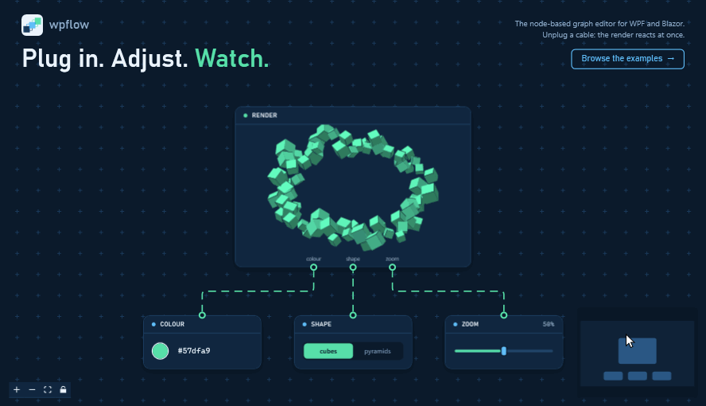

# Wpflow

**Add a node editor to your WPF or Blazor application.**

Wpflow displays boxes (the *nodes*) connected by links (the *edges*), which the user moves and connects with the mouse. It is used to build workflow editors, data pipelines, visual programming and interactive diagrams. It is a .NET port inspired by [React Flow (xyflow)](https://reactflow.dev/).



**[See the documentation and interactive examples](https://bizouarn.github.io/wpflow/)** (the Blazor examples run in the browser)

## What the library does

- **Navigate**: zoom, pan the view, minimap and control buttons.
- **Edit**: move, select, connect, reconnect, delete, undo and redo.
- **Customize**: a node can contain your own WPF controls or Blazor components. Edges, markers and colours are replaceable, with a light and a dark theme.
- **Organize**: groups and nested nodes, resizing, snap to grid, automatic layout.
- **Save**: JSON import and export in React Flow's format.
- **Integrate**: MVVM binding and commands in WPF, `@bind` and `EventCallback` in Blazor.
- **Handle large graphs**: virtualisation limits rendering to what is near the visible area.

## Installation

| NuGet package | Install it for | Targets |
|---|---|---|
| `Wpflow.Wpf` | a WPF application (Windows) | .NET 8 and later, .NET Framework 4.7.2 |
| `Wpflow.Blazor` | a Blazor application (Server or WebAssembly) | .NET 8 and later |
| `Wpflow.Core` | working with a graph without a UI (installed with the other two) | .NET 8, .NET Framework 4.7.2, .NET Standard 2.0 |

The specifics of the older targets are described in the [quick start guide](doc/learn/01-quickstart.md).

## Quick start

For WPF, install the package:

```bash
dotnet add package Wpflow.Wpf
```

Place a `FlowView` in your window:

```xml
<Window xmlns:flow="clr-namespace:Wpflow.Wpf;assembly=Wpflow.Wpf" …>
    <flow:FlowView x:Name="Flow" FitViewOnInit="True">
        <Grid>                       <!-- the content of FlowView is an overlay above the graph -->
            <flow:MiniMap />
            <flow:FlowControls />
        </Grid>
    </flow:FlowView>
</Window>
```

Then give it nodes and edges, in the window constructor after `InitializeComponent()`:

```csharp
using Wpflow.Core;

Flow.Nodes =
[
    new Node("1", new XYPosition(0, 0),   "input",   "Start"),
    new Node("2", new XYPosition(250, 80), "default", "Step"),
    new Node("3", new XYPosition(500, 0),  "output",  "End"),
];
Flow.Edges =
[
    new Edge("e1-2", "1", "2", Animated: true),
    new Edge("e2-3", "2", "3", Type: "smoothstep", Label: "ok", MarkerEnd: EdgeMarker.ArrowClosed),
];
```

That's it: you can move the nodes, connect their connection points (*handles*), zoom with the mouse wheel and pan the view by dragging the background.

## Quick start (Blazor)

Install the package:

```bash
dotnet add package Wpflow.Blazor
```

Add the stylesheet to the host page:

```html
<link rel="stylesheet" href="_content/Wpflow.Blazor/wpflow.css" />
```

Then use `FlowView` in an interactive component:

```razor
@using Wpflow.Blazor
@using Wpflow.Core

<div style="height: 500px">
    <FlowView @bind-Nodes="_nodes" @bind-Edges="_edges">
        <FlowMiniMap />
        <FlowControls />
    </FlowView>
</div>

@code {
    private IReadOnlyList<Node> _nodes =
    [
        new Node("1", new XYPosition(0, 0), "input", "Start"),
        new Node("2", new XYPosition(250, 80), "default", "Step"),
    ];
    private IReadOnlyList<Edge> _edges = [new Edge("e1-2", "1", "2", Animated: true)];
}
```

## Going further

| I want to… | Guide |
|---|---|
| understand the model and manage state | [Concepts](doc/learn/02-concepts.md), [Building a flow](doc/learn/03-building-a-flow.md) |
| create my own nodes and edges | [Custom nodes](doc/learn/04-custom-nodes.md), [Edges](doc/learn/05-edges.md), [Customization](doc/learn/14-customization.md) |
| tune gestures and connections | [Interactions](doc/learn/09-interactions.md) |
| use ViewModels (WPF) | [MVVM](doc/learn/13-mvvm.md) |
| save and reload a graph | [Saving and JSON](doc/learn/12-serialization.md) |
| display thousands of nodes | [Performance and accessibility](doc/learn/11-performance-accessibility.md) |
| use the Blazor version | [Wpflow.Blazor](doc/blazor.md) |

The [full documentation](doc/README.md) also contains the API reference and the examples. If you come from React Flow, the [`FlowView` reference](doc/reference/flowview.md) gives the equivalents.

## Known limitations

- The two versions do not share everything: the MVVM adapter (`NodesSource`) exists only in WPF.
- In Blazor, screen readers and browsers other than Chrome have not been verified.
- Connection validation (`IsValidConnection`) is synchronous: there is no asynchronous version.

## Development

Run the following commands from the repository root:

```bash
dotnet run --project demo/wpf         # WPF demo; « Browse the examples » opens the other cases
ASPNETCORE_ENVIRONMENT=Development dotnet run --project demo/blazor --urls http://localhost:5189   # Blazor Server demo
dotnet run --project demo/blazor-wasm --urls http://localhost:5190                                 # Blazor WebAssembly demo
dotnet run --project demo/docs-site   # documentation site, on http://localhost:5191
dotnet test tests/Wpflow.Core.Tests
```

The sources are in `src/`: `Wpflow.Core` contains the logic without any UI, `Wpflow.Wpf` and `Wpflow.Blazor` are the two views. To contribute, read [`CLAUDE.md`](CLAUDE.md) (architecture, commands and tests) and [`work-doc/`](work-doc/) (roadmap and architecture decisions).

## License

[MIT](LICENSE). The port of xyflow, also under the MIT license, is listed in [THIRD-PARTY-NOTICES.md](THIRD-PARTY-NOTICES.md).
