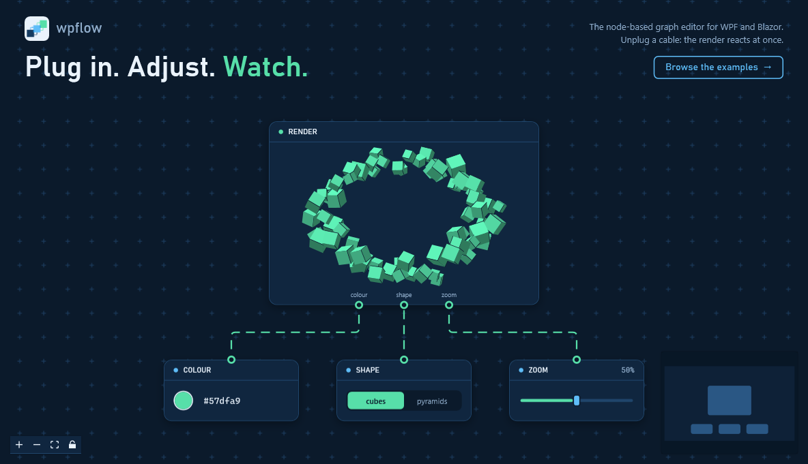

# Examples

All examples are in the `demo/` folder and run with:

```bash
dotnet run --project demo/wpf
```

The home page (« Plug in. Adjust. Watch. ») shows three settings wired to a render node; its **« Browse the examples »** button opens the examples window (one tab per case). Each example is checked by a self-test that drives the real mouse and keyboard (see `CLAUDE.md`).



## Home page: computing with a flow

*Files: `demo/wpf/MainWindow.xaml`, `MainWindow.xaml.cs`, `DemoState.cs`, `CubeField.cs`.*

The page is driven by a ViewModel (`HomeViewModel.cs`: nodes, edges and viewport are bound, no logic in the view) — see [MVVM](../learn/13-mvvm.md).

Three settings nodes (colour, shape, zoom) in a row, connected by animated cables with rounded corners (`smoothstep`) to the « render » node placed above it, which draws a ring of **animated 3D solids**. Each setting only acts while its cable exists: delete the zoom cable and the zoom falls back to its default value; reconnect it and the slider takes over again (the zoom follows with some inertia). The view also shows its own theme (`Flow.*` keys redefined in `FlowView.Resources`), a cross-pattern background and styled handles.

- The colour picker is a real `Popup` (swatches and a hue slider); the colour also changes when a hexadecimal code is typed.
- The « render » node is resizable (`NodeResizer`).

Detailed guide: [Computing with a flow](../learn/10-computing-flows.md).

## Edge types

*Tab « Edge types » — `ExamplesWindow.xaml.cs`, `BuildEdgeTypes`.*

`default`, `straight`, `step`, `smoothstep`; arrows (`MarkerEnd` / `MarkerStart`), animated edges, labels as pills (`EdgeLabelTemplate`), and an edge that leaves the bottom of one node and arrives at the left of another. The edges are blue thanks to a local override of `Flow.Edge`.

Guide: [Edges](../learn/05-edges.md).

## Groups

*Tab « Groups ».*

A group with two children whose positions are relative (`ParentId`, `ExtentParent`). Move the group: the children follow; drag a child out of the group: it stays inside; delete the group: the children disappear with it. Keyboard navigation (Tab, arrow keys).

Guide: [Sub-flows and groups](../learn/06-sub-flows.md).

## Toolbar and resizer

*Tab « Toolbar and resizer » — template `wpflow-node-tool`.*

Select a node: its toolbar (Duplicate, Delete, bound to `ICommand`s in `Node.Data`) appears above it, and eight handles let you resize it.

Guide: [Custom nodes](../learn/04-custom-nodes.md).

## Palette (drag and drop)

*Tab « Palette ».*

Drag « Input node », « Default node » or « Output node » from the left column onto the surface: a node of the matching type is created where the drop happened (`DropRequested`). Line background (`BackgroundVariant.Lines`).

Guide: [Interactions](../learn/09-interactions.md#drag-and-drop-from-a-palette).

## Automatic layout

*Tab « Auto layout ».*

Seven nodes placed at random; « Auto layout » arranges them in layers from left to right (`GraphLayout.LayeredLeftToRight`), « Shuffle » scatters them again.

Guide: [Automatic layout](../learn/07-layouting.md).

## Options and JSON

*Tab « Options and JSON ».*

Check boxes for: dark mode, `Loose` connection mode, snap to grid, locking, pan limit (`TranslateExtent`), and an `IsValidConnection` that refuses connections to « Node D ». « Export JSON » writes the graph into the text box, « Import JSON » loads it back.

Guides: [Theming](../learn/08-theming.md), [Interactions](../learn/09-interactions.md), [JSON](../learn/12-serialization.md).

## Customization

*Tab « Customization » — `demo/wpf/CustomizationExample.xaml`, `CustomEdges.cs`.*

Everything comes from resources, without touching the library: a redefined `default` node, diamond-shaped handles (implicit style with a `Template`), a `wave` edge type (an `IEdgePathProvider`), a `pulse` type drawn by a `DataTemplate` with its own label, `dot` and `diamond` markers, and a dashed connection preview.

Guide: [Customization](../learn/14-customization.md).

## MVVM

*Tab « MVVM » — `demo/wpf/MvvmExample.xaml`, `MvvmViewModel.cs`.*

Nodes and edges are ViewModels (`NodesSource`, `EdgesSource`): dragging a node writes `X`/`Y` into the ViewModel; buttons (ViewModel commands) add, delete or reposition nodes; the selection is bound to an `ObservableCollection`; and the title is a `TextBox` bound to `Data.Title`.

Guide: [MVVM](../learn/13-mvvm.md).

## Performance

*Tab « Performance ».*

« Load 3,000 nodes » with or without virtualisation (`OnlyRenderVisibleElements`); the text shows how many nodes are actually rendered (around 260 out of 3,000 when virtualised, the others do not exist).

Guide: [Performance and accessibility](../learn/11-performance-accessibility.md).

## Measuring performance from the command line

```bash
WPFLOW_PERF=5000 WPFLOW_PERF_VIRT=1 WPFLOW_SCREENSHOT="chemin/perf.png" dotnet run --project demo/wpf --no-build
# writes chemin/perf.perf.log: display time, ms per frame while dragging and panning
```

## React Flow example equivalents

| React Flow example | In Wpflow |
|---|---|
| Overview / Basic | Quick start, home page |
| Custom Node, Add Node on Edge Drop | Custom nodes, palette |
| Edge Types, Custom Edge, Edge Label Renderer | Edge types |
| Sub Flows / Nested | Groups |
| Node Resizer, Node Toolbar | Toolbar and resizer |
| Drag and Drop | Palette |
| Layouting | Automatic layout |
| Dark Mode | Options and JSON |
| Save and Restore | Options and JSON |
| Computing Flows | Home page |
| Validation | Options and JSON (`IsValidConnection`) |
| Stress | Performance |
| State Management (store) | MVVM |
